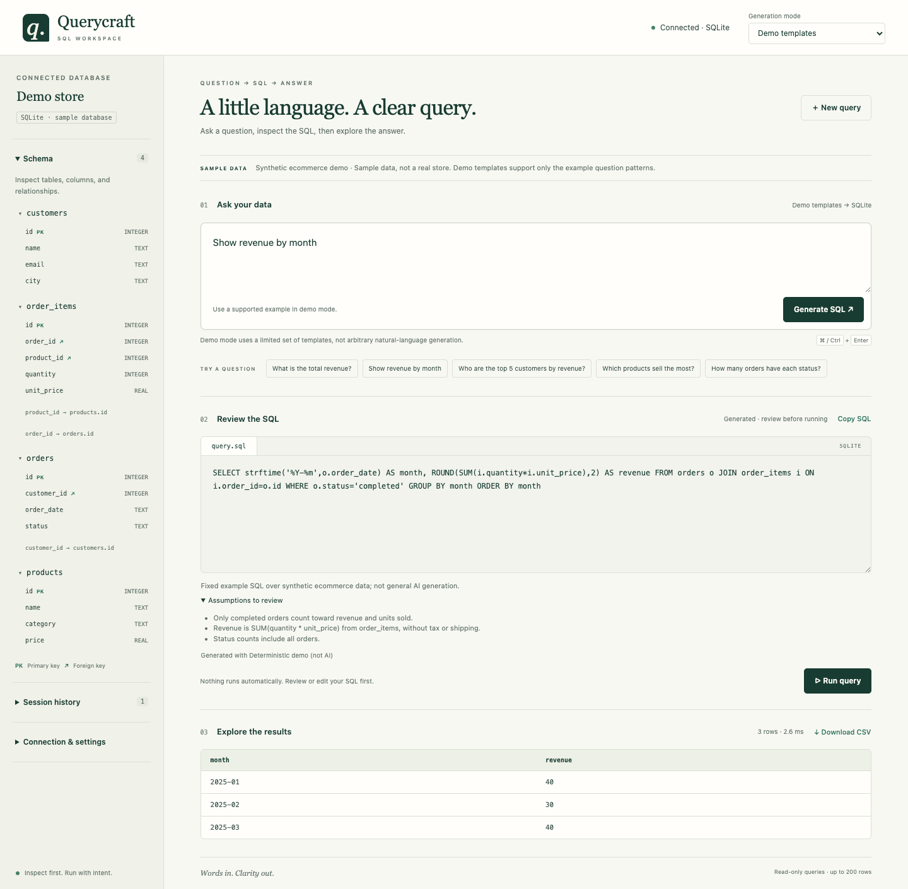
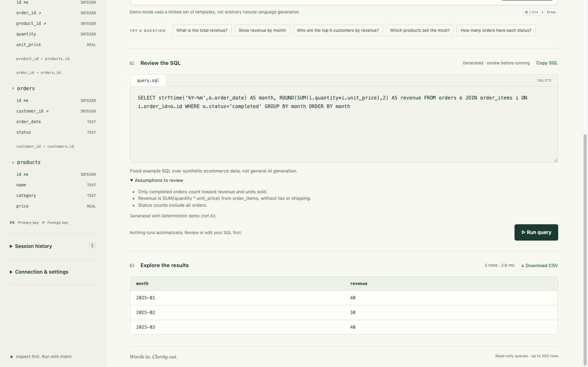
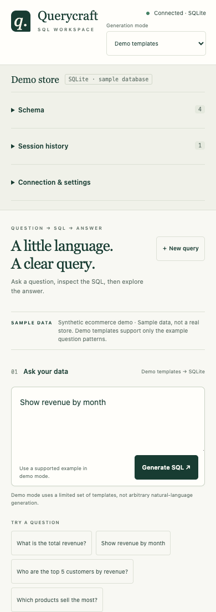

# Querycraft

**Ask a question. Inspect the SQL. Run it when you are ready.**

Querycraft is a local-first natural-language-to-SQL workbench built with **Python, Flask, SQLite, SQLGlot, and vanilla JavaScript**. It pairs schema-aware query generation with an editable SQL workspace and an explicit review-before-run workflow.

This is an independent implementation inspired by PandasAI's separation of generation, validation, and execution—not a fork or a PandasAI integration. It does not execute generated Python.



*Actual application capture using the bundled synthetic ecommerce database. Demo templates are deterministic, not live AI inference.*

## Features

- **Schema explorer:** discover tables, column types, primary keys, and foreign-key relationships.
- **Question to SQL:** configure an OpenAI-compatible Chat Completions provider for general questions, or try the five no-key demo examples.
- **Review before execution:** inspect the generated query, explanation, and assumptions; edit SQL before running it.
- **Read-only results:** run a validated SQLite SELECT/CTE query and inspect its results, execution timing, and truncation status.
- **CSV export:** download results with quote escaping and spreadsheet-formula protection.
- **Session history:** restore recent questions and SQL without storing result rows.
- **Result fidelity:** preserve integer IDs beyond JavaScript's safe range and represent binary values as hexadecimal.
- **Responsive interface:** use the workbench on desktop or mobile without a frontend build step.

## Screenshots

### SQL review and results



### Mobile workspace



All screenshots show the real running application with synthetic sample data. No customer data or credentials are included.

## Quick start

**Requirements:** Python 3.9 or newer. No Node.js, database installation, account, or API key is needed for demo mode.

After downloading and extracting the repository:

```bash
cd querycraft
python3 -m venv .venv
source .venv/bin/activate
python -m pip install -r requirements.txt
python run.py
```

On Windows, activate with `.venv\Scripts\activate` instead.

Open **http://127.0.0.1:5055** in your browser. The server binds to loopback only. The synthetic demo database is created automatically on first use.

### Try the no-key demo

1. Select one of the example questions.
2. Click **Generate SQL**.
3. Review the SQL, explanation, and assumptions.
4. Click **Run query**.
5. Inspect the results or download a CSV.

Supported demo questions:

- What is the total revenue?
- Show revenue by month
- Who are the top 5 customers by revenue?
- Which products sell the most?
- How many orders have each status?

**Demo mode uses five exact templates, not arbitrary natural-language understanding.** Revenue templates count completed orders only and calculate quantity × historical line-item unit price, excluding tax and shipping. The bundled dataset is deliberately small and entirely synthetic.

You can also enter a read-only SQLite query directly in the editor.

## Configure an AI provider

General free-form questions require an **OpenAI-compatible Chat Completions endpoint**. Configure the server environment before starting the application:

```bash
export LLM_BASE_URL='https://api.openai.com/v1'
export LLM_MODEL='your-supported-chat-model'
# Set LLM_API_KEY securely in your shell environment.
python run.py
```

Then choose **AI provider** in the interface. For a local compatible model server, use its `/v1` base URL and served model ID; an API key is optional for loopback endpoints. Remote endpoints require HTTPS and an API key.

`.env.example` documents the variable names and contains no credentials. **Environment files are not loaded automatically.** Never paste an API key into a question, commit a populated environment file, or embed credentials in source code.

Only the **question and database schema metadata** are sent to the configured model. Sample rows and query results are not sent. Questions and schema names can still contain sensitive information, so review your provider's data policies before using private data. Model cost, availability, and retention depend on your provider.

Model output is validated locally, but SQL validity does not prove that a query correctly answers your business question. Always review joins, filters, date ranges, and assumptions. **Live LLM inference was not exercised during the included verification; provider tests use controlled HTTP responses.**

## Connect your own SQLite database

```bash
export QUERYCRAFT_DB='/absolute/path/to/existing.sqlite'
python run.py
```

The file must already exist. Querycraft opens it read-only and never seeds or overwrites a configured custom database. Schema metadata is discovered automatically. Use AI provider mode or write SQL manually; bundled demo templates are disabled for custom databases.

## Architecture

```text
Question + discovered schema
          |
          v
Demo template / OpenAI-compatible provider
          |
          v
Structured response validation
          |
          v
SQLGlot AST checks + SQLite compilation
          |
          v
Editable SQL + explanation + assumptions
          |
          v
Explicit user action: Run query
          |
          v
Read-only SQLite execution -> results -> safe CSV export
```

| Layer | Technology | Responsibility |
| --- | --- | --- |
| Backend | Python, Flask | Local API, request validation, orchestration |
| Query engine | SQLite, SQLGlot | Schema discovery, AST validation, read-only execution |
| Model adapter | HTTPX | Server-side OpenAI-compatible HTTP requests |
| Interface | HTML, CSS, JavaScript | Question composer, SQL editor, results, export |
| Tests | pytest, browser scripts | Engine, API, security boundaries, result fidelity |

## Safeguards and limitations

- Generation and execution are separate; generating SQL does not fetch result rows.
- AST validation rejects mutations, stacked statements, and disallowed SQL constructs.
- Read-only SQLite URI, query-only mode, and a SQLite authorizer provide additional barriers.
- Query execution uses a time budget and a **200-row response cap**; truncation is visible.
- Local-host and same-origin checks, JSON-only POSTs, a request-size limit, and a Content Security Policy protect the local interface.
- Database values are rendered as text, not HTML. CSV exports neutralize formula-like cell values.
- Unsafe-range integer values are serialized as decimal strings to avoid browser rounding. Binary values remain hex objects in the API and display/export with a `0x` prefix.

These controls are **not an OS sandbox, authentication system, or absolute resource-isolation guarantee**. Use trusted database files, preferably disposable copies. This is a loopback-only Flask development application; do not expose it publicly or treat it as a production multi-tenant service.

This version supports **SQLite only**. PostgreSQL/MySQL, CSV upload, automatic charting, and conversational agent memory are not implemented.

## API

| Method | Endpoint | Purpose |
| --- | --- | --- |
| GET | `/api/health` | Local service health |
| GET | `/api/status` | Database identity, examples, provider availability |
| GET | `/api/schema` | Tables, columns, foreign keys |
| POST | `/api/generate` | Generate SQL from `{ "question": "...", "mode": "demo" }` or `"llm"` |
| POST | `/api/execute` | Execute `{ "sql": "SELECT ..." }` read-only |

Errors return JSON with an `error` field. Database paths and model endpoints are configured server-side, not supplied through request parameters.

## Tests

```bash
python -m pip install -r requirements-dev.txt
python -m pytest -q
```

**92 automated tests pass** in the verified build. Coverage includes schema discovery, demo queries, provider request/response handling, request boundaries, read-only restrictions, query limits, and exact result serialization.

For browser regression checks, open the demo and run the async expressions from `tests/browser-smoke.js` and `tests/browser-fidelity.js` in browser DevTools. These exercise the real local API, rendered tables, and captured CSV blobs without making model requests. Browser checks are separate from pytest.

See [verification notes](docs/verification.md) for the exercised paths and boundaries.

## Project structure

```text
querycraft/
  core.py                 Schema, generation, validation, execution
  web.py                  Flask API and local request boundary
templates/index.html      Workbench markup
static/                   Browser-side CSS and JavaScript
tests/                    Python and browser regression tests
docs/
  images/                 Real application screenshots
  reference.md            PandasAI reference study
  verification.md         Verification scope and results
run.py                    Loopback-only server entry point
.env.example              Variable names only; no credentials
SECURITY.md               Credential handling and local-use boundaries
```

## Reference

See [reference notes](docs/reference.md) for the PandasAI source files reviewed and the independent implementation decisions. No PandasAI implementation code or enterprise features were copied. Dependencies retain their respective licenses.

## Uploading to GitHub

Extract the distribution ZIP and upload the **contents of its `querycraft/` folder** to the root of your repository. Keep `docs/images/` alongside `README.md` so the screenshots render correctly. The ZIP excludes environment secrets, local databases, virtual environments, caches, Git history, and previous ZIP files.

Review any future changes for credentials before pushing; the included `.gitignore` helps prevent accidental inclusion but is not a secret scanner.
